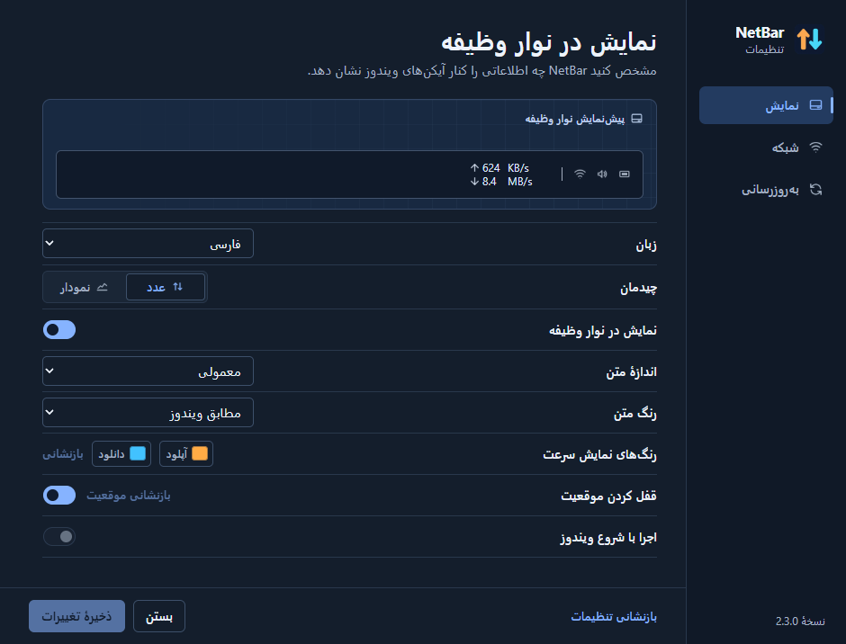
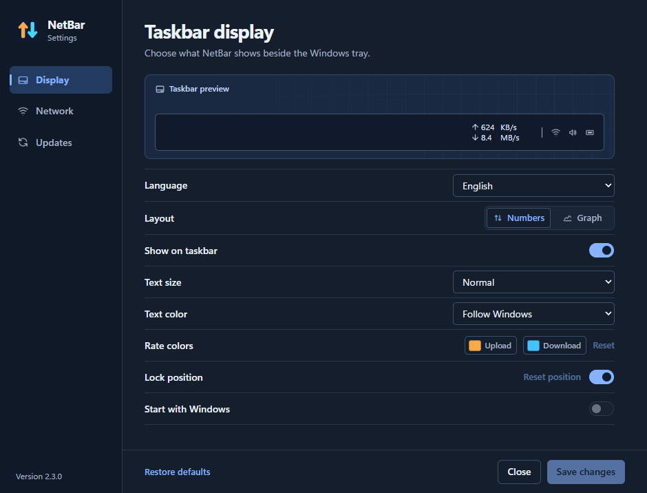

<div dir="rtl" lang="fa">

# نت‌بار (NetBar)

**فارسی** · [English](README.md)

[](https://github.com/a-nahvi/monitor-network-taskbar/actions/workflows/ci.yml)

نت‌بار سرعت لحظه‌ای آپلود و دانلود را کنار آیکن‌های ناحیهٔ اعلان ویندوز ۱۱ نسخهٔ ۶۴ بیتی نمایش می‌دهد. سرعت را می‌توان به‌صورت عدد یا روی نمودار ۶۰ ثانیه‌ای دید. برنامه با Rust و Tauri ساخته شده و ویجت نوار وظیفه را روی یک تصویر بیت‌مپ ترسیم می‌کند که برای استفادهٔ دوباره در حافظه نگه داشته می‌شود.

**[دانلود آخرین نصب‌کنندهٔ ویندوز](https://github.com/a-nahvi/monitor-network-taskbar/releases/latest)** · [گزارش مشکل](https://github.com/a-nahvi/monitor-network-taskbar/issues)

## نصب و به‌روزرسانی

1. فایل <span dir="ltr">`NetBar-<version>-Setup-x64.msi`</span> را از آخرین انتشار GitHub دانلود و اجرا کنید.
2. پس از نصب، در تنظیمات به **به‌روزرسانی ← بررسی به‌روزرسانی** بروید. در رابط انگلیسی این مسیر <span dir="ltr">**Settings → Updates → Check for updates**</span> است. اگر نسخه‌ای در دسترس بود، **نصب به‌روزرسانی** یا **Install update** را انتخاب کنید.

به‌روزرسانی از دانلودهای عمومی GitHub Releases استفاده می‌کند. اگر نسخه‌ای قدیمی خطای محدودیت درخواست یا ورود به GitHub نشان داد، آخرین فایل MSI را اجرا کنید. نصب‌کننده برای حساب کاربری فعلی اجرا می‌شود و نسخهٔ MSI موجود را با حفظ تنظیمات و میان‌بر اجرای خودکار ارتقا می‌دهد. تنظیمات در <span dir="ltr">`%LocalAppData%\NetBar\NetBar.ini`</span> ذخیره می‌شوند. برای حذف برنامه به <span dir="ltr">**Windows Settings → Apps → Installed apps**</span> بروید.

نت‌بار پیش از اجرای Windows Installer اندازهٔ فایل، مقدار SHA-256 و شناسهٔ بستهٔ MSI را بررسی می‌کند. اگر فایل را دستی دانلود کرده‌اید، خروجی دستور زیر را با <span dir="ltr">`NetBar-<version>-SHA256.txt`</span> مقایسه کنید. این فایل از نسخهٔ <span dir="ltr">2.2.1</span> همراه انتشارها ارائه می‌شود.

<div dir="ltr">

```powershell
Get-FileHash -Algorithm SHA256 -Path .\NetBar-*-Setup-x64.msi
```

</div>

## استفاده از NetBar

- روی ویجت **راست‌کلیک** کنید و از منو **توقف نمایش سرعت** یا **ادامهٔ نمایش سرعت** را انتخاب کنید. ردیف بالا سرعت آپلود و ردیف پایین سرعت دانلود را نشان می‌دهد.
- روی ویجت **دوبار کلیک** کنید یا **تنظیمات** را از منوی همان ویجت باز کنید. اگر ویجت پنهان است، **NetBar** را از منوی شروع ویندوز باز کنید. چیدمان، رنگ‌ها، موقعیت و اجرای خودکار را در بخش **نمایش** تنظیم کنید. برای جابه‌جایی ویجت، قفل موقعیت را باز کنید و ویجت را بکشید.
- از **نمایش ← زبان** فارسی یا انگلیسی را انتخاب کنید و **ذخیرهٔ تغییرات** را بزنید. در رابط انگلیسی، مسیر <span dir="ltr">**Display → Language**</span> و دکمهٔ **Save changes** را پیدا کنید. چیدمان تنظیمات بلافاصله با انتخاب فارسی راست‌به‌چپ و با انتخاب انگلیسی چپ‌به‌راست می‌شود. منوی ویجت هم به زبان ذخیره‌شده نمایش داده می‌شود.
- در بخش **شبکه** آداپتور، فاصلهٔ به‌روزرسانی و واحد سرعت را تعیین کنید. می‌توانید بین بایت بر ثانیه و بیت بر ثانیه جابه‌جا شوید. حالت خودکار به آداپتور فیزیکی فعال اولویت می‌دهد تا ترافیک VPN دوبار شمرده نشود.

ویجت روی نوار وظیفهٔ افقی اصلی نمایش داده می‌شود. هنگام استفاده از برنامه‌های تمام‌صفحه یا وقتی نوار وظیفه از دید خارج می‌شود، ویجت پنهان می‌شود. با باز کردن تنظیمات، محیط اجرای WebView2 که همراه ویندوز ۱۱ ارائه می‌شود بارگذاری می‌شود. [Microsoft Edge WebView2](https://developer.microsoft.com/microsoft-edge/webview2/)

## تصاویر تنظیمات

### فارسی، راست‌به‌چپ (RTL)



### انگلیسی، چپ‌به‌راست (LTR)



## کارایی

هر نسخه روی یک رایانه با ویندوز ۱۱ نسخهٔ ۶۴ بیتی، پس از ۱۲ ثانیه آماده‌سازی، به‌مدت ۴۵ ثانیه اندازه‌گیری شد. در طول آزمایش، ویجت عددی روی نوار وظیفه با فاصلهٔ به‌روزرسانی یک‌ثانیه‌ای فعال بود و پنجرهٔ تنظیمات بسته بود. اندازه‌گیری‌ها فرایند NetBar و فرایندهای زیرمجموعهٔ آن را پوشش می‌دهند.

| نسخه | میانهٔ حافظهٔ خصوصی | میانگین مصرف پردازنده (یک هستهٔ منطقی) | تعداد فرایندهای WebView2 |
| --- | ---: | ---: | ---: |
| 2.1.1 | <span dir="ltr">150.7 MiB</span> | <span dir="ltr">0.94%</span> | 6 |
| 2.2.0 | <span dir="ltr">2.9 MiB</span> | <span dir="ltr">0.17%</span> | 0 |

## ساخت از کد منبع

در ویندوز، Rust نسخهٔ ۱٫۹۰ یا جدیدتر با هدف ساخت <span dir="ltr">`x86_64-pc-windows-msvc`</span>، ابزارهای Visual Studio C++ Build Tools، یک Windows SDK و PowerShell 7 را نصب کنید. دستورهای زیر را در پوشهٔ اصلی مخزن اجرا کنید.

<div dir="ltr">

```powershell
cargo test --locked
pwsh -File .\scripts\release.ps1
```

</div>

فایل MSI و فایل بررسی SHA-256 در پوشهٔ <span dir="ltr">`dist`</span> ساخته می‌شوند. برای پیش‌نمایش تنظیمات در محیط جداگانه، <span dir="ltr">`NetBar.exe --inspect-ui --config <path>`</span> را اجرا کنید. گردش‌کار انتشار صحت نصب‌کننده و ارتقا از نسخهٔ <span dir="ltr">1.3.0</span> را آزمایش می‌کند.

[تاریخچهٔ تغییرات](CHANGELOG.md) · [راهنمای مشارکت](CONTRIBUTING.md) · [گزارش مسائل امنیتی](SECURITY.md)

## مجوز

نت‌بار با مجوز MIT منتشر می‌شود. پیکان‌های نمایش سرعت از مجموعهٔ Feather Icons هستند و متن مجوزشان در مخزن قرار دارد. [مجوز MIT](LICENSE) · [Feather Icons](https://feathericons.com/) · [متن مجوز آیکن‌ها](frontend/licenses/feather.txt)

</div>
