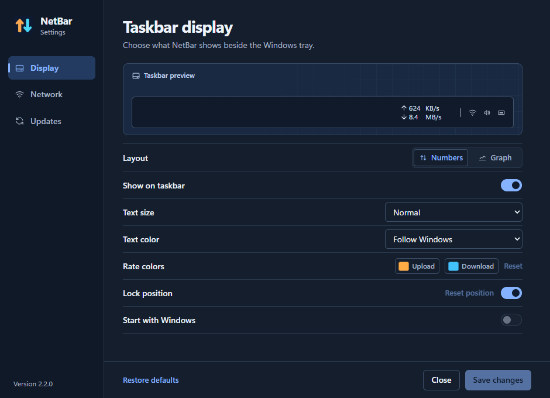

# NetBar

[](https://github.com/a-nahvi/monitor-network-taskbar/actions/workflows/ci.yml)

Live upload and download rates next to the system tray on Windows 11 x64. Use compact numbers or a 60-second graph. NetBar is built with Rust and Tauri and draws the taskbar widget to a cached Windows bitmap.

**[Download the latest Windows installer](https://github.com/a-nahvi/monitor-network-taskbar/releases/latest)** · [Report an issue](https://github.com/a-nahvi/monitor-network-taskbar/issues)



## Install and update

1. Download `NetBar-<version>-Setup-x64.msi` from the latest GitHub release and run it.
2. After installation, open **Settings → Updates → Check for updates**. If an update is available, select **Install update**.

Downloads and update checks use anonymous access to GitHub. If an older build reports a GitHub sign-in error, upgrade using the latest MSI. The per-user installer upgrades an existing MSI installation in place and preserves preferences and the Startup shortcut. Preferences are stored in `%LocalAppData%\NetBar\NetBar.ini`. To uninstall, open **Windows Settings → Apps → Installed apps**.

NetBar checks the download size, SHA-256 digest, and MSI identity before opening Windows Installer. For a manual download, compare the output below with `NetBar-<version>-SHA256.txt`, included with releases from 2.2.1 onward.

```powershell
Get-FileHash -Algorithm SHA256 -Path .\NetBar-*-Setup-x64.msi
```

## Use NetBar

- **Right-click** the widget to pause or resume readings. Upload is the top row and download is the bottom row.
- **Double-click** the widget or select **Settings** from the tray menu. Use **Display** for the layout, colors, position, and startup. Unlock the widget to drag it along the taskbar.
- Choose English or Persian under **Display → Language**, then select **Save changes**. English uses a left-to-right settings layout. Persian uses a right-to-left layout.
- Use **Network** to select an adapter, change the refresh interval, or switch between bytes and bits per second. Automatic selection prefers an active physical adapter to avoid double-counting VPN traffic.

The widget runs on the primary horizontal taskbar. It hides over fullscreen applications and when the taskbar moves out of view. Opening Settings loads the Microsoft Edge WebView2 Runtime included with Windows 11. [Microsoft Edge WebView2](https://developer.microsoft.com/microsoft-edge/webview2/)

## Performance

The table shows a 45-second run per version on one Windows 11 x64 machine after a 12-second warm-up. The numerical widget was visible with one-second updates and Settings was closed. Measurements include the NetBar process and its descendants.

| Version | Median private memory | Average CPU (one logical core) | WebView2 processes |
| --- | ---: | ---: | ---: |
| 2.1.1 | 150.7 MiB | 0.94% | 6 |
| 2.2.0 | 2.9 MiB | 0.17% | 0 |

## Build from source

On Windows, install Rust 1.90 or later with the `x86_64-pc-windows-msvc` target, Visual Studio C++ Build Tools, a Windows SDK, and PowerShell 7. Run these commands from the repository root.

```powershell
cargo test --locked
pwsh -File .\scripts\release.ps1
```

The build writes the MSI and SHA-256 checksum to `dist`. To preview Settings in isolation, run `NetBar.exe --inspect-ui --config <path>`. The release workflow verifies the installer and tests an upgrade from version 1.3.0.

[Changelog](CHANGELOG.md) · [Contributing](CONTRIBUTING.md) · [Security reporting](SECURITY.md)

## License

NetBar is released under the [MIT License](LICENSE). The arrows are from [Feather Icons](https://feathericons.com/) and their [license notice](frontend/licenses/feather.txt) is included.
